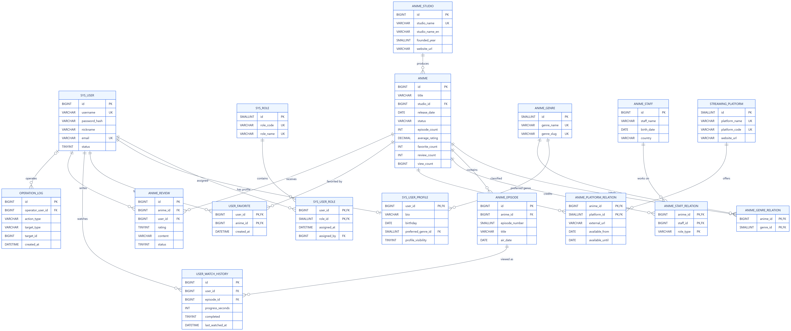
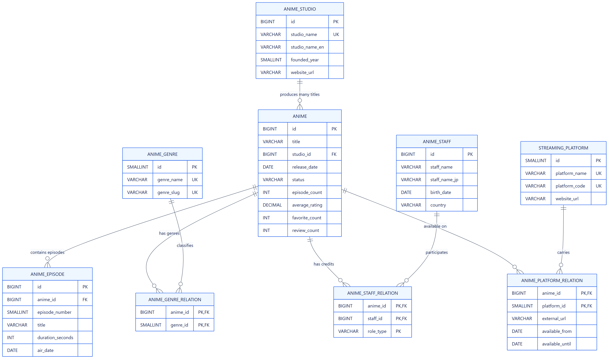
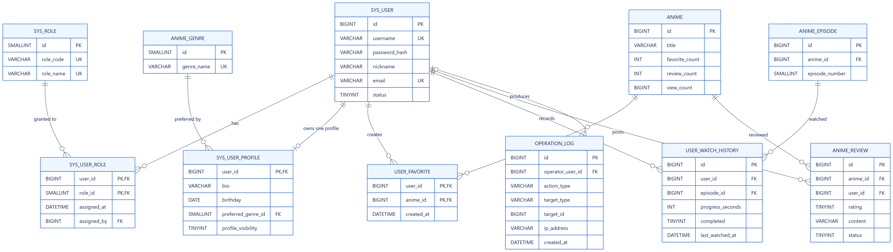
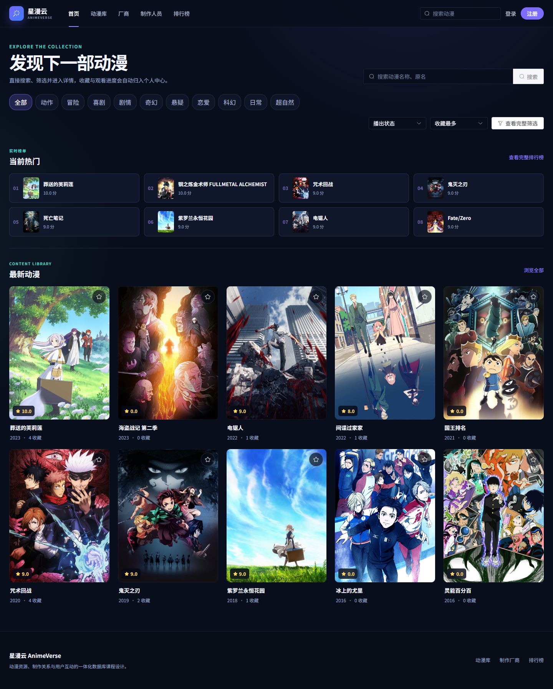
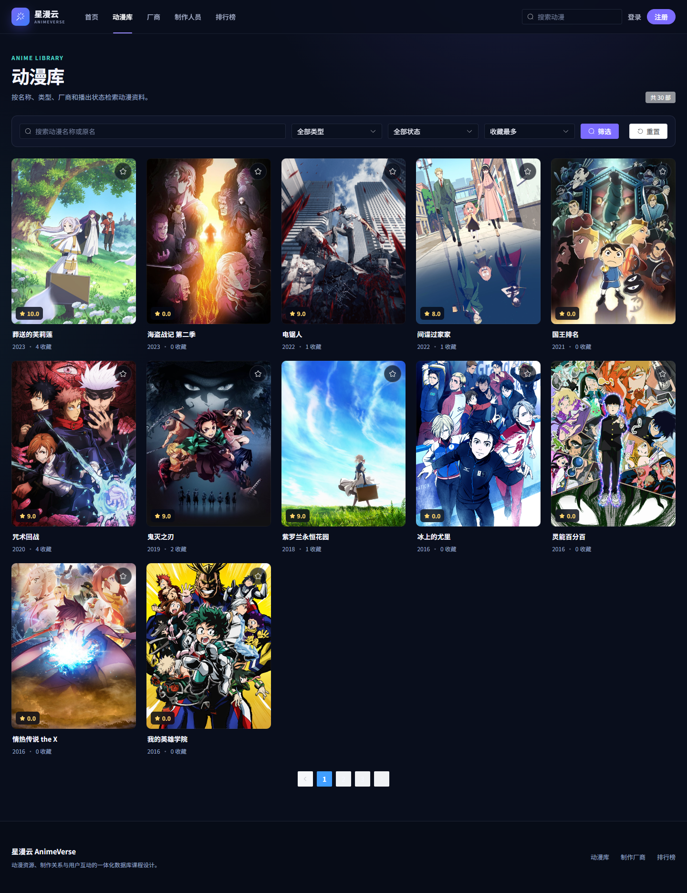
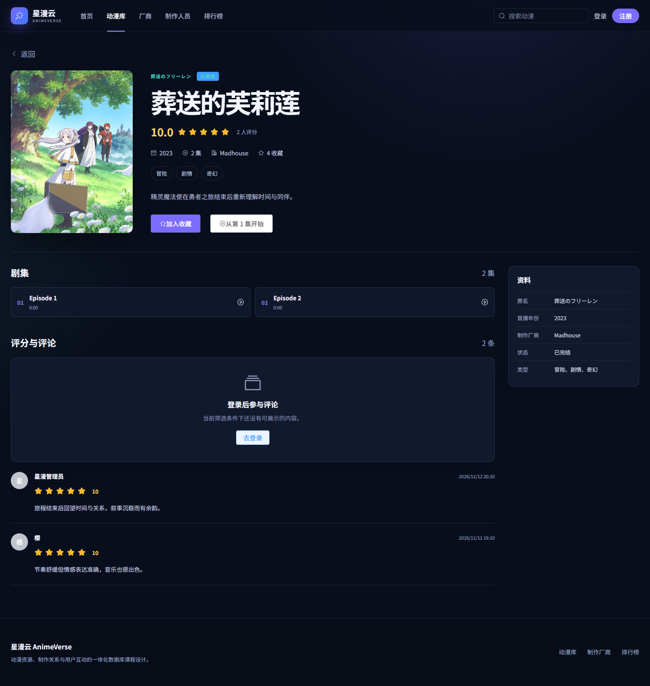
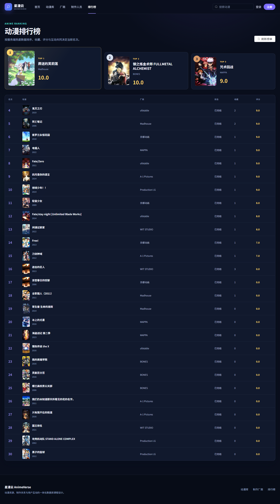
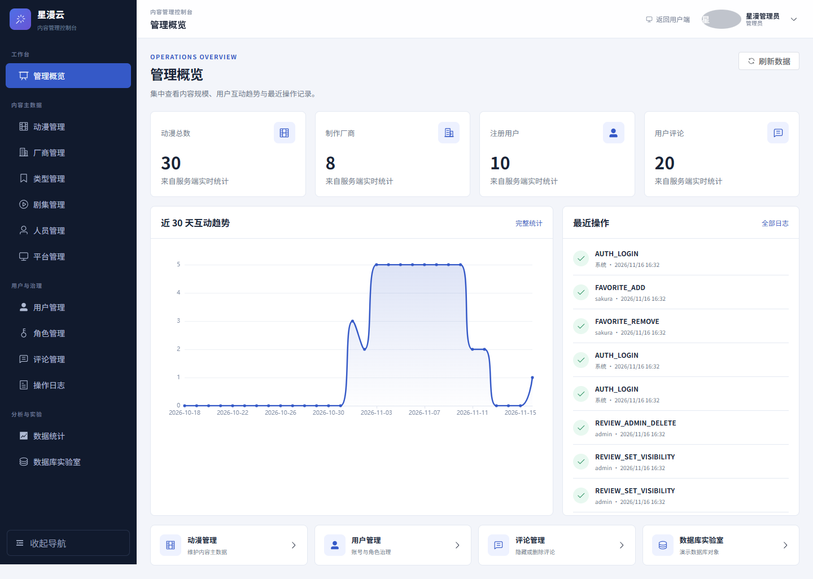
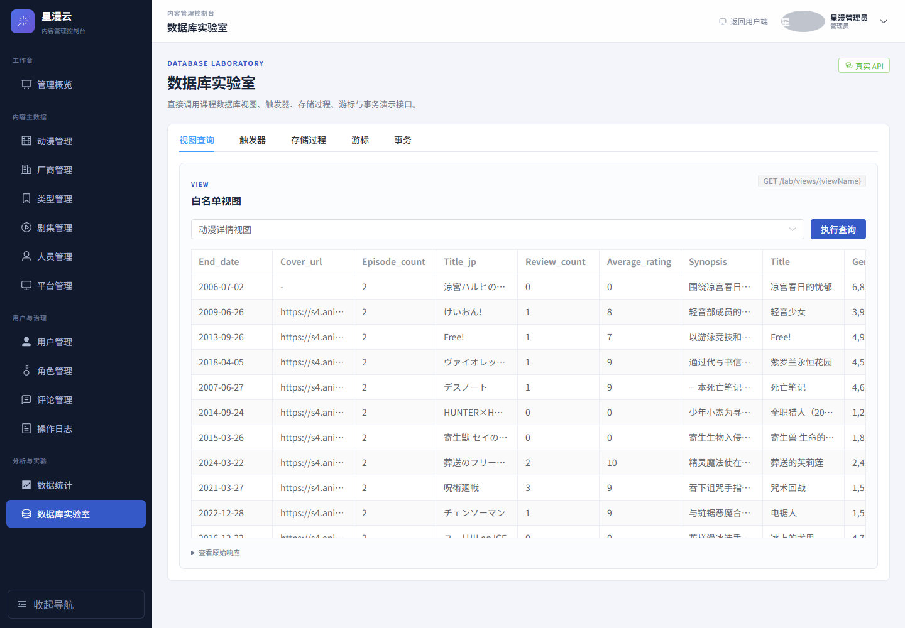
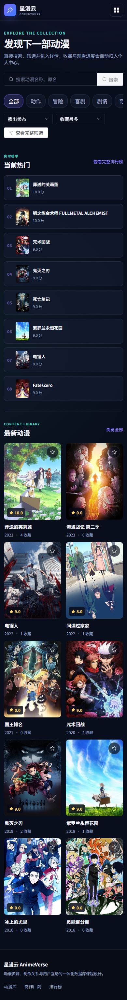

# 星漫云动漫资源与制作厂商管理平台数据库课程设计报告

学校：____________________

专业：____________________

班级：____________________

组员：____________________

指导教师：____________________

完成日期：____________________

## 摘要

本项目完成了一个可真实运行的动漫资源与制作厂商管理平台。系统以 MySQL 8.0 的 `anime_platform` 数据库为核心，使用 Spring Boot 3 提供 REST 接口，使用 Vue 3 构建普通用户端和管理员端。数据库包含 17 张业务表、4 个视图、12 个触发器、6 个存储过程、3 个函数，并通过游标、事务、约束、索引和最小权限账户覆盖数据库课程的主要知识点。

项目使用真实 MySQL 数据完成测试。最终数据库测试 17/17 通过，API 联调测试 22/22 通过，后端测试 17/17 通过，前端单元测试 4/4 通过，真实浏览器回归 19/19 通过且无控制台、HTTP 或横向溢出问题。系统已生成可编辑的 Markdown/DOCX 报告、操作手册、故障排查手册、8 张运行截图、ER 图和独立验收材料。

关键词：MySQL；动漫管理；E-R 模型；触发器；存储过程；游标；Spring Boot；Vue 3

## 第一章 绪论

### 1.1 项目背景

动漫平台同时涉及作品、制作厂商、制作人员、类型、剧集、播放平台和用户互动。若把这些信息全部放在一张表中，会产生大量重复字段，并难以保证收藏、评论、评分和剧集计数的一致性。本项目将内容主数据、关系数据、用户互动数据和审计数据拆分到不同关系表，形成边界清晰的数据库设计。

项目不仅提供页面展示，还要求普通用户、管理员和数据库实验三类场景都通过真实接口访问 MySQL。数据库实验室中的视图查询、触发器实验、存储过程、游标和事务演示均由后端直接调用数据库对象。

### 1.2 建设目标

系统需要完成以下目标：

1. 对动漫、厂商、类型、剧集、制作人员和播放平台进行结构化维护。
2. 支持注册登录、浏览检索、收藏、观看记录、评论和个人资料。
3. 支持管理员 CRUD、用户与角色管理、评论治理、操作日志和统计分析。
4. 使用主键、外键、唯一约束、CHECK、索引和触发器保证数据质量。
5. 使用视图、函数、存储过程、游标和事务完成课程高级数据库实验。
6. 使用 JWT、BCrypt、RBAC 和最小数据库权限控制访问。
7. 提供可部署、可测试、可复现和可提交的完整项目包。

### 1.3 技术路线

| 层次 | 技术 | 用途 |
|---|---|---|
| 数据库 | MySQL 8.0.43、InnoDB、utf8mb4 | 持久化、约束、视图和高级对象 |
| 后端 | Java 17、Spring Boot 3.3.7、MyBatis-Plus | REST API、事务和数据库访问 |
| 安全 | Spring Security、JWT、BCrypt | 认证、授权和密码哈希 |
| 接口文档 | SpringDoc OpenAPI | `/v3/api-docs` 和 Swagger UI |
| 前端 | Vue 3、TypeScript、Vite、Element Plus | 用户端和管理后台 |
| 状态与请求 | Pinia、Vue Router、Axios | 会话、路由和接口调用 |
| 可视化 | ECharts、Mermaid、Graphviz | 统计图和 ER 图 |
| 文档 | Markdown、DOCX、PNG、SVG | 报告、手册和证据材料 |

### 1.4 项目范围与边界

项目定位为 Windows 本地课程演示系统，不包含支付、视频转码、版权采购、生产级编排或多租户能力。播放平台关系为本地快照，部分封面来自 AniList CDN，断网时使用占位；动漫 ID 1 有本地备用封面。

## 第二章 需求分析

### 2.1 用户角色

| 角色 | 主要能力 |
|---|---|
| 游客 | 浏览首页、动漫列表、详情、厂商、制作人员、排行榜和公开评论 |
| 普通用户 | 在游客能力上增加收藏、取消收藏、观看记录、评论、个人资料维护 |
| 管理员 | 管理内容主数据、用户、角色、评论、日志、统计和数据库实验室 |

### 2.2 功能需求

普通用户端包含 13 个页面：登录、注册、首页、动漫库、动漫详情、厂商列表、厂商详情、制作人员、排行榜、我的收藏、观看历史、我的评论和个人中心。管理员端包含 13 个页面：管理概览、动漫管理、厂商管理、类型管理、剧集管理、制作人员管理、播放平台管理、用户管理、角色管理、评论管理、操作日志、数据统计和数据库实验室。

数据库实验室提供五类实验：

1. 视图实验：从四个白名单视图中选择并读取真实结果。
2. 触发器实验：写入或删除收藏，对比动漫收藏计数。
3. 存储过程实验：新增动漫、查询厂商统计、调用排行榜。
4. 游标实验：返回逐厂商作品数、平均分和收藏总量。
5. 事务实验：验证提交可见、回滚不可见和异常回滚。

### 2.3 核心业务规则

1. 一部动漫必须属于一个制作厂商；被作品引用的厂商不能直接删除。
2. 动漫与类型、制作人员、播放平台均为多对多关系，通过关系表实现。
3. 同一用户对同一动漫最多收藏一次、评论一次。
4. 同一用户对同一剧集只保留一条最新观看进度。
5. 评论评分范围为 1 到 10，正文长度为 1 到 2000 字符。
6. 动漫收藏数、可见评论数、平均分、观看记录数和集数必须与来源数据一致。
7. 用户密码只保存 BCrypt 哈希。
8. 删除用户时清理其互动数据，但保留操作日志并将操作者置空。

### 2.4 数据边界

| 数据域 | 表 | 职责 |
|---|---|---|
| 身份权限 | `sys_user`, `sys_role`, `sys_user_role` | 登录主体、角色和多对多授权 |
| 用户资料 | `sys_user_profile` | 与用户共享主键的一对一扩展资料 |
| 内容主数据 | `anime_studio`, `anime`, `anime_genre` | 厂商、作品和类型 |
| 内容关系 | `anime_genre_relation`, `anime_episode`, `anime_staff`, `anime_staff_relation`, `streaming_platform`, `anime_platform_relation` | 分类、剧集、制作人员和平台发行 |
| 用户互动 | `user_favorite`, `user_watch_history`, `anime_review` | 收藏、观看和评论 |
| 审计 | `operation_log` | 管理操作、事务演示和安全追踪 |

### 2.5 非功能需求

系统要求页面响应式、错误可读、空状态明确、表单有校验、删除有确认、列表可分页和搜索。数据库要求全部使用 InnoDB 与 utf8mb4，脚本可重复执行，不自动删除数据库。应用账户仅对目标库拥有必要 DML 和过程执行权限。

## 第三章 数据库概念结构设计

### 3.1 实体和主键

| 实体 | 主键 | 候选键或说明 |
|---|---|---|
| 用户 | `sys_user.id` | `username`, `email` |
| 角色 | `sys_role.id` | `role_code`, `role_name` |
| 用户资料 | `sys_user_profile.user_id` | 与用户共享主键，严格一对一 |
| 制作厂商 | `anime_studio.id` | `studio_name` |
| 动漫 | `anime.id` | `(title, release_date)` |
| 类型 | `anime_genre.id` | `genre_name`, `genre_slug` |
| 剧集 | `anime_episode.id` | `(anime_id, episode_number)` |
| 制作人员 | `anime_staff.id` | 姓名配合业务关系使用 |
| 播放平台 | `streaming_platform.id` | `platform_name`, `platform_code` |
| 收藏 | `(user_id, anime_id)` | 复合主键阻止重复 |
| 观看历史 | `user_watch_history.id` | `(user_id, episode_id)` 唯一 |
| 评论 | `anime_review.id` | `(user_id, anime_id)` 唯一 |
| 操作日志 | `operation_log.id` | 审计流水号 |

### 3.2 联系与基数

| 联系 | 基数 | 实现 |
|---|---|---|
| 用户与角色 | M:N | `sys_user_role` |
| 用户与资料 | 1:0..1 | 共享主键 |
| 厂商与动漫 | 1:N | `anime.studio_id` |
| 动漫与类型 | M:N | `anime_genre_relation` |
| 动漫与剧集 | 1:N | `anime_episode.anime_id` |
| 动漫与制作人员 | M:N，带职务 | `anime_staff_relation` |
| 动漫与播放平台 | M:N | `anime_platform_relation` |
| 用户与动漫收藏 | M:N | `user_favorite` |
| 用户与剧集进度 | 1:N，按用户和剧集唯一 | `user_watch_history` |
| 用户与动漫评论 | 1:N，按用户和动漫唯一 | `anime_review` |

### 3.3 全局 E-R 图



### 3.4 制作业务 E-R 图



### 3.5 用户互动 E-R 图



### 3.6 范式分析

第一范式要求字段原子化。系统没有在动漫表中保存逗号分隔的类型或人员列表，而是使用关系表。

第二范式要求复合主键的非键属性完全依赖整个主键。`anime_staff_relation` 的职务依赖动漫、人员和职务三元组；`user_favorite.created_at` 依赖用户与动漫组合；不存在只依赖复合主键一部分的字段。

第三范式要求非键属性只依赖本实体主键。厂商名称、类型名称和平台名称通过外键引用，不在动漫表中重复保存。动漫表中的收藏数、评论数、评分和集数属于受控派生字段，来源可追溯，并由触发器和回算脚本维护，应用写入契约不提供这些字段，因此它们是读取性能设计而非不可解释冗余。

## 第四章 数据库逻辑结构设计

### 4.1 关系模式

- `sys_user(id PK, username UK, password_hash, nickname, email UK, avatar_url, status, last_login_at, created_at, updated_at)`
- `sys_role(id PK, role_code UK, role_name UK, description, created_at)`
- `sys_user_role(user_id PK/FK, role_id PK/FK, assigned_at, assigned_by FK)`
- `sys_user_profile(user_id PK/FK, bio, birthday, preferred_genre_id FK, profile_visibility, updated_at)`
- `anime_studio(id PK, studio_name UK, studio_name_en, country, founded_year, website_url, logo_url, description, timestamps)`
- `anime(id PK, title, title_jp, title_en, studio_id FK, synopsis, cover_url, release_date, end_date, status, aggregate fields, timestamps)`
- `anime_genre(id PK, genre_name UK, genre_slug UK, description, created_at)`
- `anime_genre_relation(anime_id PK/FK, genre_id PK/FK, created_at)`
- `anime_episode(id PK, anime_id FK, episode_number, title, synopsis, duration_seconds, air_date, timestamps)`
- `anime_staff(id PK, staff_name, staff_name_jp, birth_date, country, avatar_url, bio, timestamps)`
- `anime_staff_relation(anime_id PK/FK, staff_id PK/FK, role_type PK, created_at)`
- `streaming_platform(id PK, platform_name UK, platform_code UK, website_url, country, is_active, timestamps)`
- `anime_platform_relation(anime_id PK/FK, platform_id PK/FK, external_url, available_from, available_until, created_at)`
- `user_favorite(user_id PK/FK, anime_id PK/FK, created_at)`
- `user_watch_history(id PK, user_id FK, episode_id FK, progress_seconds, completed, last_watched_at, created_at)`
- `anime_review(id PK, anime_id FK, user_id FK, rating, content, status, timestamps)`
- `operation_log(id PK, operator_user_id FK, action_type, target_type, target_id, description, ip_address, created_at)`

### 4.2 多对多转换

`sys_user_role`、`anime_genre_relation`、`anime_staff_relation`、`anime_platform_relation` 和 `user_favorite` 均使用复合主键。复合主键同时承担自然唯一约束，使数据库本身能够拒绝重复授权、重复分类、重复人员关系和重复收藏。

### 4.3 外键删除策略

| 关系 | 策略 | 业务原因 |
|---|---|---|
| 用户角色、用户资料、用户互动 | CASCADE | 主体的派生数据随主体删除 |
| 动漫类型、剧集、人员、平台关系 | 动漫侧 CASCADE | 作品删除后关系失去意义 |
| 厂商、类型、人员、平台主数据 | RESTRICT | 存在引用时阻止误删 |
| 日志操作者 | SET NULL | 保留审计事实 |

### 4.4 完整性约束

实体完整性由显式主键保证。域完整性由数据类型、非空、唯一、CHECK 和枚举约束保证。参照完整性由 20 个外键保证。动画评分必须在 0 到 10，评论评分必须在 1 到 10，剧集时长必须在 60 到 36000 秒，用户名、角色代码、类型 slug 和平台代码通过正则约束检查。

## 第五章 数据库物理结构设计

### 5.1 存储参数

数据库 `anime_platform` 使用 MySQL 8.0，17 张表全部为 InnoDB，字符集为 utf8mb4，排序规则为 `utf8mb4_0900_ai_ci`。实测有 20 个外键、23 个 CHECK 约束、14 个唯一约束和 51 个索引。所有时间字段使用 `DATETIME`，主键使用无符号整数。

### 5.2 表级数据字典

| 表 | 主键 | 关键约束 | 业务含义 |
|---|---|---|---|
| `sys_user` | `id` | 用户名、邮箱唯一；BCrypt、状态 CHECK | 用户登录主体 |
| `sys_role` | `id` | 角色代码、名称唯一 | RBAC 角色 |
| `sys_user_role` | `(user_id, role_id)` | 用户/角色外键 | 用户角色授权 |
| `sys_user_profile` | `user_id` | 共享主键、偏好类型外键 | 一对一资料 |
| `anime_studio` | `id` | 名称唯一、成立年份 CHECK | 制作厂商 |
| `anime` | `id` | 标题+日期唯一、空日期函数唯一索引、厂商外键、状态/评分/日期 CHECK | 动漫作品 |
| `anime_genre` | `id` | 名称、slug 唯一 | 类型字典 |
| `anime_genre_relation` | `(anime_id, genre_id)` | 双外键、动漫级联 | 动漫类型关系 |
| `anime_episode` | `id` | `(anime_id, episode_number)` 唯一，时长 CHECK | 剧集 |
| `anime_staff` | `id` | 姓名索引 | 制作人员 |
| `anime_staff_relation` | `(anime_id, staff_id, role_type)` | 职务枚举 CHECK | 人员职务关系 |
| `streaming_platform` | `id` | 名称、代码唯一，启用 CHECK | 播放平台 |
| `anime_platform_relation` | `(anime_id, platform_id)` | 上架日期顺序 CHECK | 平台发行关系 |
| `user_favorite` | `(user_id, anime_id)` | 双外键、复合 PK | 用户收藏 |
| `user_watch_history` | `id` | 用户+剧集唯一，进度/完成 CHECK | 观看进度 |
| `anime_review` | `id` | 用户+动漫唯一，评分/正文/状态 CHECK | 评论与评分 |
| `operation_log` | `id` | 用户外键 SET NULL，三类检索索引 | 审计日志 |

完整字段级数据字典见项目文件 `docs/database/data-dictionary.md`。下表给出最核心的动漫表字段摘要。

| 字段 | 类型 | 约束 | 含义 |
|---|---|---|---|
| `id` | BIGINT UNSIGNED | PK, AUTO_INCREMENT | 动漫编号 |
| `title` | VARCHAR(160) | NOT NULL | 中文标题 |
| `studio_id` | BIGINT UNSIGNED | FK, NOT NULL | 制作厂商 |
| `release_date` | DATE | 与标题组成唯一键 | 首播日期 |
| `status` | VARCHAR(20) | UPCOMING/AIRING/COMPLETED | 播出状态 |
| `episode_count` | INT UNSIGNED | 非负，触发器维护，应用只读 | 剧集数 |
| `average_rating` | DECIMAL(4,2) | 0..10，触发器维护，应用只读 | 平均评分 |
| `favorite_count` | INT UNSIGNED | 非负，触发器维护，应用只读 | 收藏数 |
| `review_count` | INT UNSIGNED | 非负，触发器维护，应用只读 | 可见评论数 |
| `view_count` | BIGINT UNSIGNED | 非负，触发器维护，应用只读 | 观看记录数 |

### 5.3 索引设计

索引按真实筛选和聚合路径建立：

1. 动漫按厂商、状态与日期、评分、互动热度建立索引。
2. 剧集按动漫与播出日期建立联合索引。
3. 人员关系按人员与职务建立联合索引。
4. 收藏按动漫和创建时间建立索引。
5. 观看按用户与最近时间、剧集建立索引。
6. 评论按动漫与创建时间、用户建立索引。
7. 日志按用户与时间、动作与时间、目标对象建立索引。
8. 动漫标题使用 `uk_anime_title_release_key` 函数唯一索引，将空发行日期归一化，避免 MySQL 普通唯一约束对 NULL 不去重。

### 5.4 关键建表代码

```sql
CREATE TABLE IF NOT EXISTS anime (
    id BIGINT UNSIGNED NOT NULL AUTO_INCREMENT,
    title VARCHAR(160) NOT NULL,
    studio_id BIGINT UNSIGNED NOT NULL,
    release_date DATE NULL,
    status VARCHAR(20) NOT NULL DEFAULT 'COMPLETED',
    episode_count INT UNSIGNED NOT NULL DEFAULT 0,
    average_rating DECIMAL(4,2) NOT NULL DEFAULT 0.00,
    favorite_count INT UNSIGNED NOT NULL DEFAULT 0,
    review_count INT UNSIGNED NOT NULL DEFAULT 0,
    view_count BIGINT UNSIGNED NOT NULL DEFAULT 0,
    CONSTRAINT pk_anime PRIMARY KEY (id),
    CONSTRAINT uk_anime_title_release UNIQUE (title, release_date),
    CONSTRAINT fk_anime_studio FOREIGN KEY (studio_id)
        REFERENCES anime_studio (id) ON UPDATE RESTRICT ON DELETE RESTRICT,
    CONSTRAINT ck_anime_status
        CHECK (status IN ('UPCOMING', 'AIRING', 'COMPLETED')),
    CONSTRAINT ck_anime_rating CHECK (average_rating BETWEEN 0 AND 10)
) ENGINE=InnoDB DEFAULT CHARSET=utf8mb4;
CREATE UNIQUE INDEX uk_anime_title_release_key ON anime (title, (COALESCE(release_date, '1900-01-01')));
```

## 第六章 基表操作和视图实现

### 6.1 初始化与种子数据

管理员初始化脚本先检查数据库和账户是否存在，不执行 `DROP DATABASE`。建库和授权完成后，按固定顺序加载表、种子、封面、函数、视图、游标过程、存储过程、触发器和计数回算脚本。实测种子规模如下。

| 数据 | 实测行数 |
|---|---:|
| 制作厂商 | 8 |
| 动漫 | 30 |
| 类型 | 10 |
| 剧集 | 60 |
| 制作人员 | 20 |
| 播放平台 | 6 |
| 用户 | 10 |
| 用户资料 | 10 |
| 收藏 | 30 |
| 观看记录 | 30 |
| 评论 | 20 |

### 6.2 基表 CRUD

项目为 17 张表提供 CRUD 或等价管理路径。管理员可以维护动漫、厂商、类型、剧集、制作人员和平台；普通用户可以维护自己的资料、收藏、观看进度和评论。CRUD 测试使用事务执行创建、查询、更新和删除，最后回滚，不污染演示种子。

```sql
START TRANSACTION;

INSERT INTO anime_genre (genre_name, genre_slug, description)
VALUES ('测试类型', 'test-genre', 'CRUD 回滚测试');

UPDATE anime_genre
SET description = 'CRUD 更新测试'
WHERE genre_slug = 'test-genre';

DELETE FROM anime_genre
WHERE genre_slug = 'test-genre';

ROLLBACK;
```

### 6.3 复杂查询

`database/queries/complex_queries.sql` 包含 18 条真实查询，覆盖多表连接、聚合、分组、`HAVING`、子查询、`EXISTS`、`NOT EXISTS`、窗口函数、CTE、日期筛选、模糊搜索和多条件组合。实测 18 条全部执行成功。

```sql
WITH ranked AS (
    SELECT
        a.id,
        a.title,
        s.studio_name,
        a.average_rating,
        a.favorite_count,
        ROW_NUMBER() OVER (
            PARTITION BY a.studio_id
            ORDER BY a.average_rating DESC, a.favorite_count DESC
        ) AS studio_rank
    FROM anime a
    JOIN anime_studio s ON s.id = a.studio_id
)
SELECT *
FROM ranked
WHERE studio_rank <= 3;
```

### 6.4 视图

| 视图 | 结果行数 | 用途 |
|---|---:|---|
| `v_anime_detail` | 30 | 动漫、厂商、类型和计数详情 |
| `v_studio_statistics` | 8 | 厂商作品、评分和互动汇总 |
| `v_anime_popularity` | 30 | 加权热度与排名 |
| `v_user_activity` | 10 | 用户角色和互动汇总 |

视图包含聚合、表达式、窗口函数或多表连接，通常不直接更新。业务写入必须回到基表或存储过程，以避免不可预期的更新语义。

```sql
CREATE OR REPLACE VIEW v_anime_popularity AS
SELECT
    a.id,
    a.title,
    a.average_rating,
    a.favorite_count,
    a.review_count,
    a.view_count,
    ROUND(
        a.average_rating * 0.7
        + LEAST(a.favorite_count, 100) * 0.2
        + LEAST(a.review_count, 100) * 0.1,
        2
    ) AS popularity_score
FROM anime a;
```

## 第七章 数据库高级编程

### 7.1 触发器

项目实测创建 12 个触发器，用于维护收藏、评论、观看和剧集计数。

| 触发器 | 行为 |
|---|---|
| 收藏新增/更新/删除 | 新增和删除维护 `favorite_count`；更新时处理用户或作品键迁移 |
| 评论新增 | 可见评论更新平均分、评分数和评论数 |
| 评论更新 | 处理改分、隐藏、恢复和迁移作品，并从可见评论重新计算平均值 |
| 评论删除 | 回退平均分和评论数 |
| 观看新增/更新/删除 | 维护 `view_count`，关系迁移时同步旧作品和新作品 |
| 剧集新增/更新/删除 | 维护 `episode_count`，集数迁移时同步旧作品和新作品 |

重复收藏和重复评论由复合主键与唯一约束阻止，因此触发器不会重复累计。无符号字段、`GREATEST` 和 CHECK 共同防止负数。三个 UPDATE 触发器补齐了收藏、观看和剧集从一部作品迁移到另一部作品时的双向计数一致性。

```sql
CREATE TRIGGER trg_user_favorite_after_insert
AFTER INSERT ON user_favorite
FOR EACH ROW
BEGIN
    UPDATE anime
    SET favorite_count = favorite_count + 1
    WHERE id = NEW.anime_id;
END;
```

### 7.2 函数

3 个函数均已实测执行：

1. `fn_anime_weighted_score(anime_id)`：结合评分、收藏和评论计算加权分。
2. `fn_user_watch_minutes(user_id)`：将观看秒数折算为分钟。
3. `fn_visible_review_average(anime_id)`：实时计算可见评论平均分，用于核对触发器结果。

### 7.3 存储过程

| 过程 | 参数 | 实测用途 |
|---|---|---|
| `sp_add_anime` | 8 IN + 1 OUT | 校验并事务新增动漫 |
| `sp_get_studio_statistics` | 1 IN + 5 OUT | 厂商作品数、均分和互动总量 |
| `sp_get_anime_ranking` | 1 IN | 返回限制长度的排行结果集 |
| `sp_delete_anime` | 1 IN + 1 OUT | 校验并删除无阻断引用的作品 |
| `sp_transaction_demo` | 2 IN + 1 OUT | 提交、回滚和异常回滚 |
| `sp_generate_studio_report` | 无 | 游标逐厂商生成报表 |

```sql
CREATE PROCEDURE sp_get_studio_statistics(
    IN p_studio_id BIGINT UNSIGNED,
    OUT p_studio_name VARCHAR(120),
    OUT p_anime_count INT,
    OUT p_avg_rating DECIMAL(5,2),
    OUT p_favorite_total BIGINT,
    OUT p_review_total BIGINT
)
BEGIN
    IF NOT EXISTS (SELECT 1 FROM anime_studio WHERE id = p_studio_id) THEN
        SIGNAL SQLSTATE '45000'
            SET MESSAGE_TEXT = 'studio does not exist';
    END IF;

    SELECT
        s.studio_name,
        COUNT(a.id),
        COALESCE(ROUND(AVG(a.average_rating), 2), 0),
        COALESCE(SUM(a.favorite_count), 0),
        COALESCE(SUM(a.review_count), 0)
    INTO
        p_studio_name,
        p_anime_count,
        p_avg_rating,
        p_favorite_total,
        p_review_total
    FROM anime_studio s
    LEFT JOIN anime a ON a.studio_id = s.id
    WHERE s.id = p_studio_id
    GROUP BY s.id, s.studio_name;
END;
```

### 7.4 游标

`sp_generate_studio_report` 真实声明游标和 `CONTINUE HANDLER FOR NOT FOUND`，通过 `OPEN`、`FETCH`、`LOOP` 和 `CLOSE` 遍历 8 家厂商。每行写入临时表，最后返回厂商名、作品数、平均分和收藏总数。API 实测返回 8 行。

```sql
DECLARE studio_cursor CURSOR FOR
    SELECT id, studio_name FROM anime_studio ORDER BY id;
DECLARE CONTINUE HANDLER FOR NOT FOUND SET v_done = TRUE;

OPEN studio_cursor;
read_loop: LOOP
    FETCH studio_cursor INTO v_studio_id, v_studio_name;
    IF v_done THEN
        LEAVE read_loop;
    END IF;
    INSERT INTO tmp_studio_report
    SELECT v_studio_name, COUNT(a.id), AVG(a.average_rating),
           SUM(a.favorite_count)
    FROM anime a
    WHERE a.studio_id = v_studio_id;
END LOOP;
CLOSE studio_cursor;
```

### 7.5 事务

事务测试验证 `commit` 提交 1 行、`rollback` 回滚 0 行、`exception` 由 `SIGNAL` 触发 `EXIT HANDLER` 后回滚并重抛且为 0 行。数据库测试在断言前后清理自身事务演示标记，避免前序 API 审计记录影响执行顺序。

## 第八章 UI 设计与实现

### 8.1 设计方向

用户端采用深色蓝紫视觉体系，以封面为主要内容锚点；管理员端采用浅色工作台和深色侧边栏，突出表格、筛选、分页和重复操作效率。两端共享字体层级、状态标签、空状态、加载状态和错误反馈规则。

### 8.2 用户端页面

用户端共 13 个页面，覆盖首页检索、内容浏览、厂商和人员信息、排行榜及个人互动。动漫卡片具有评分、年份、收藏数和封面加载失败处理；详情页展示类型、剧集、厂商、评论和资料摘要。









### 8.3 管理员端页面

管理员端共 13 个页面。管理概览展示动画总数、厂商数、用户数、评论数、30 天趋势和最近操作。动漫、厂商、类型、剧集、人员、平台和角色七类管理页复用统一 CRUD 管理器，并针对不同实体使用实际字段和控件。



### 8.4 数据库实验室

数据库实验室的视图、触发器、存储过程、游标和事务页签均调用真实后端接口。页面显示 API 路径、操作按钮、结果表和原始响应。触发器实验对比操作前后计数；事务页签区分提交、回滚和异常。



### 8.5 响应式设计

移动端首页使用两列动漫卡片，搜索和筛选控件保持可操作，无横向溢出。真实浏览器在 390×844 视口完成截图。



## 第九章 安全控制

### 9.1 数据库账户隔离

管理员连接只用于建库、授权和对象安装。应用账户 `Chengzi@localhost` 实测仅有：

```text
GRANT USAGE ON *.* TO `Chengzi`@`localhost`
GRANT SELECT, INSERT, UPDATE, DELETE, EXECUTE, SHOW VIEW
ON `anime_platform`.* TO `Chengzi`@`localhost`
```

应用账户没有全局建库、授权、文件或管理员能力。初始化脚本不撤销其他库权限，不自动删除数据库。

### 9.2 认证与授权

后端使用 BCrypt 校验密码，登录成功后签发 JWT。JWT 过滤器恢复用户身份，管理接口要求 `ADMIN` 角色。API 实测：无令牌访问管理接口返回 401，普通用户访问返回 403。

### 9.3 SQL 注入与 XSS

MyBatis 查询使用参数绑定。模糊搜索将关键词作为参数传递，注入式关键词测试返回 0 条匹配而不是扩大结果集。前端源码不存在 `v-html`，评论和用户名不直接作为 HTML 注入。

### 9.4 凭据与日志

`.env` 被 Git 忽略，`.env.example` 只包含占位符。数据库种子只保存 BCrypt 哈希。脚本通过进程环境变量传递 MySQL 密码，避免出现在命令行参数中。管理操作写入 `operation_log`，日志在用户删除后保留。

### 9.5 剩余风险

本项目是本地课程系统，JWT 密钥和数据库密码仍依赖本地文件或环境变量。生产环境需要 TLS、密钥管理、登录限流、刷新令牌、审计归档、依赖漏洞扫描和独立迁移账户。

## 第十章 系统测试

### 10.1 测试环境

| 项目 | 实测值 |
|---|---|
| 操作系统 | Windows 10/11 本地环境 |
| 数据库 | MySQL 8.0.43，`127.0.0.1:3306` |
| 后端 | Java 17.0.21，Spring Boot 3.3.7，端口 8080 |
| 前端 | Vue 3 + Vite，端口 5173 |
| 浏览器 | Headless Chrome，桌面 1440×1000，移动 390×844 |

### 10.2 数据库测试

数据库测试最终为 17/17 通过。覆盖表与种子、12 个触发器、3 个函数、6 个存储过程、游标、commit/rollback/exception、17 表 CRUD、重复约束、CHECK、空日期同名作品函数唯一索引、18 条复杂查询和脚本安全检查。

```text
Database test summary: 17/17 passed.
```

### 10.3 后端测试

后端从 `clean package` 重新编译 129 个 Java 源文件，17 个测试全部通过。

```text
Tests run: 17, Failures: 0, Errors: 0, Skipped: 0
BUILD SUCCESS
```

### 10.4 API 联调测试

增强后的 API 测试共 22 项，全部通过。除登录、RBAC、公开页面和 CRUD 外，还验证了无效令牌隔离、停用账户 403、角色 CRUD、实验室写操作审计、排行榜字段、30 天趋势、四个视图、触发器、存储过程、游标和三种事务模式。

```text
API test summary: 22/22 passed.
```

### 10.5 前端与浏览器测试

前端单元测试 4/4 通过，TypeScript 与 Vite 构建 2361 个模块通过。真实浏览器回归 19/19 通过，七个后台实体完成创建、搜索、编辑、删除，并验证角色恢复、聚合字段只读、评论审核、收藏首次点击和 8 张桌面/移动截图；页面和数据库实验室无控制台错误、HTTP 错误或横向溢出。

```text
Frontend tests: 4/4 passed
Browser test summary: 19/19 checks passed; 0 issue(s); 0 warning(s).
```

### 10.6 问题修复记录

联合测试期间修复的主要问题包括：

1. `localhost` 与 `127.0.0.1` 跨域来源不一致。
2. 排行结果缺少 `id`、封面、年份和状态字段。
3. 前端对 `score/rating/averageRating` 字段别名处理不一致。
4. 统计数据查询在 `ONLY_FULL_GROUP_BY` 下失败。
5. 管理员 CRUD 表单与真实数据库字段不一致。
6. 普通文本字段被错误渲染为密码框。
7. 数组型后台列表搜索没有本地过滤。
8. 封面种子未包含在初始化脚本中。
9. 启动脚本使用了高于 Java 17 的默认运行时。
10. 事务测试受前序 API 审计记录影响。
11. 管理员动漫写入契约仍可赋值触发器维护的评分和计数字段。
12. 评论多次改分时旧平均值的增量算法可能产生舍入漂移。
13. 收藏、观看和剧集关系迁移时缺少 UPDATE 触发器。
14. MySQL 普通标题唯一约束允许发行日期为 NULL 的重复记录。
15. 无效或过期 Bearer 令牌会阻断公开接口。修正后过滤器清空匿名上下文并继续公开请求，受保护接口仍由安全链返回 401。
16. 停用账户登录返回的状态码不符合预期。修正后统一返回 403，API 测试会停用并立即恢复测试账户。
17. 角色表单使用错误的字段名，用户编辑时角色字符串未映射回角色 ID。前后端已统一为 `roleCode/roleName` 并恢复已有角色选择。
18. 评论 `status=0` 曾被误判为不可恢复。修正后隐藏评论可恢复显示并可继续删除。
19. 动漫卡首次点击收藏时可能先写入再取消。修正为响应中的 `favorited` 初始化状态，并增加首次点击删除回归。
20. 数据库实验室收藏和动漫写操作缺少完整审计。已为写接口增加操作日志，并增加受审计的 `sp_delete_anime` 管理接口。
21. 浏览器默认请求 `/favicon.ico` 产生 404。已增加真实 SVG 图标和显式 `<link rel="icon">`，未使用错误抑制。
22. Windows PowerShell 5.1 对无 charset 的 JSON 响应按错误编码解析，并把 mysql.exe 负向测试的 stderr 提前升级为终止错误。测试客户端改为 UTF-8 字节解析，数据库工具按退出码判定预期失败。

独立审查后已完成上述全部可自动整改项。当前应用写入不提供聚合字段，评论触发器从可见评论重算统计，三类关系均有双向 UPDATE 触发器，标题使用函数唯一索引，公开/受保护接口的无效令牌行为清晰分离，实验室写操作均有审计，并新增对应数据库、后端、API 和浏览器回归测试。

## 第十一章 总结

本项目完成了从需求、E-R 设计、关系模式、物理结构、基础操作、视图、高级数据库对象到 Spring Boot、Vue 3、安全、测试、报告和打包的完整流程。数据库对象数量和实际业务功能均经过真实环境验证，不是静态页面或 SQL 文本演示。

项目的主要优点是数据库约束与业务规则一致，触发器、存储过程和游标均真实运行，数据库实验室不是伪数据，前端 CRUD 与后端字段契约经过浏览器验证。主要边界包括远程封面依赖网络、动漫 ID 1 使用本地备用图、前端构建存在大 chunk 警告，以及本地课程环境未做生产级安全加固。

最终交付以实际文件、实时数据库对象和测试脚本输出为准。独立审查、整改和验收结论见 `docs/reports/final-independent-review.md`、`final-correction-report.md` 和 `final-acceptance-report.md`。
